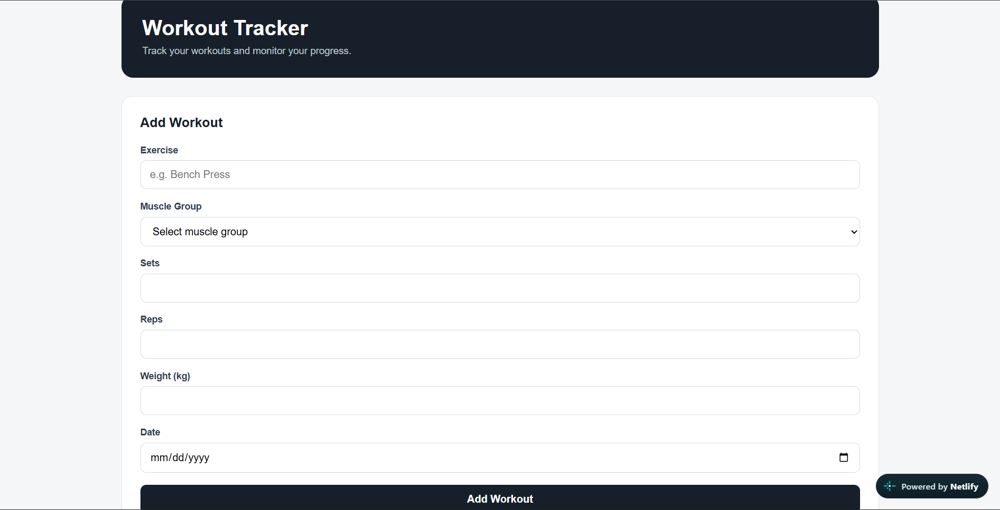
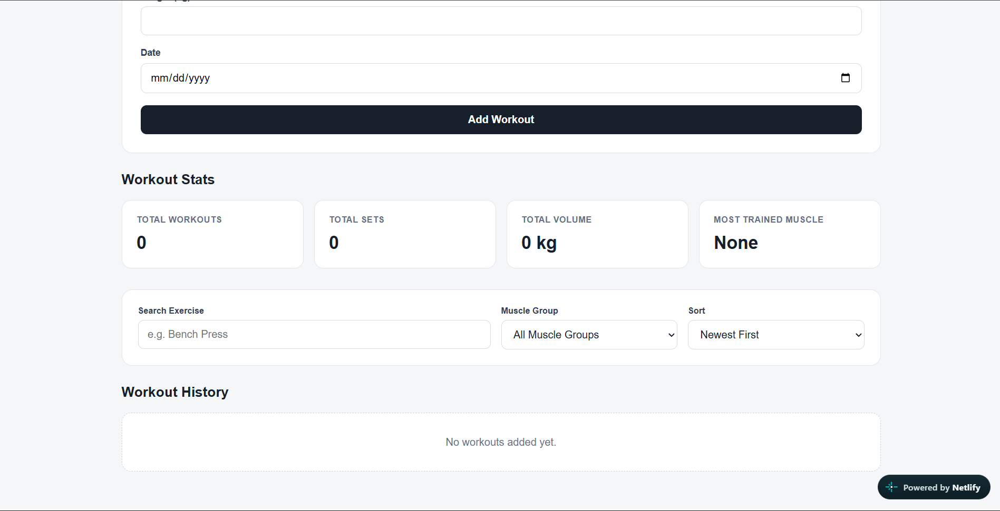

# 🏋️ Workout Tracker

A workout tracking web application built with React and Vite that helps users organize workouts, manage exercise information, and review their workout history through an interactive interface.

## 🌐 Live Demo

[**View Workout Tracker**](https://workout-tracker-by-azariya.netlify.app/)

## 📸 Screenshots

### Workout Dashboard



### Workout History and Filtering



## ✨ Features

* **Workout Management:** Add, edit, and delete workout entries.
* **Muscle Group Selection:** Select a muscle group when managing workouts.
* **Workout History:** Review previously recorded workouts.
* **Workout Filtering:** Filter workout history to find relevant entries.
* **Interactive User Interface:** Manage workout information through a React-based interface.
* **Data Persistence:** Uses browser localStorage to save workout information between visits, if enabled in the current version.

## 🛠️ Technologies Used

* **React** — building reusable UI components.
* **JavaScript (ES6+)** — application logic and interactivity.
* **Vite** — development server and build tool.
* **HTML5** — application structure.
* **CSS3** — styling and layout.
* **localStorage** — browser-based data persistence, if enabled.

## 🚀 Getting Started

Follow these steps to run the project locally.

### Prerequisites

* [Node.js](https://nodejs.org/)
* npm (included with Node.js)
* Git

### Installation

1. Clone the repository:

   ```bash
   git clone https://github.com/Azaariya/Workout-Tracker.git
   ```

2. Navigate to the project directory:

   ```bash
   cd Workout-Tracker
   ```

3. Install the project dependencies:

   ```bash
   npm install
   ```

4. Start the development server:

   ```bash
   npm run dev
   ```

5. Open the local URL displayed in your terminal to use the application.

### Production Build

To create an optimized production build, run:

```bash
npm run build
```

To preview the production build locally, run:

```bash
npm run preview
```

## 📚 What I Learned

Through this project, I practiced:

* Building reusable components with React.
* Managing component state and handling user interactions.
* Working with forms and collecting user input.
* Implementing workout creation, editing, and deletion.
* Organizing workouts by muscle group.
* Displaying and filtering workout history.
* Using Vite to develop and build a React application.
* Working with browser localStorage, if enabled in the current version.

## 🔮 Future Improvements

* Add workout statistics and progress charts.
* Track sets, repetitions, weights, and workout duration.
* Add personalized workout plans.
* Improve filtering and searching options.
* Enhance the mobile experience.

## 👨‍💻 Author

**Azaria**

Electrical and Computer Engineering student at Addis Ababa Science and Technology University.

* **GitHub:** [@Azaariya](https://github.com/Azaariya)
* **Live Project:** [Workout Tracker](https://workout-tracker-by-azariya.netlify.app/)

---

⭐ If you find this project interesting, feel free to explore the repository and try the live demo!
